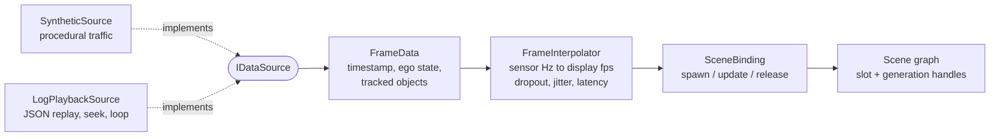
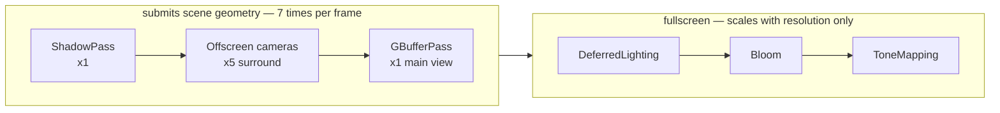
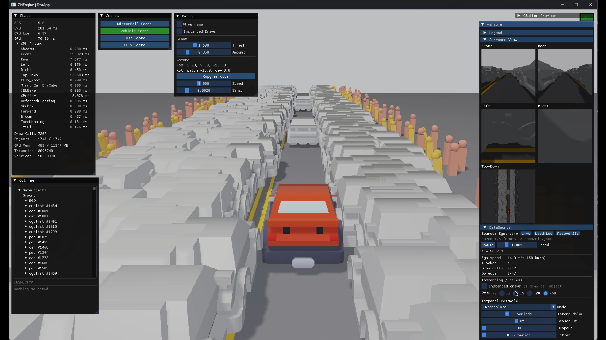
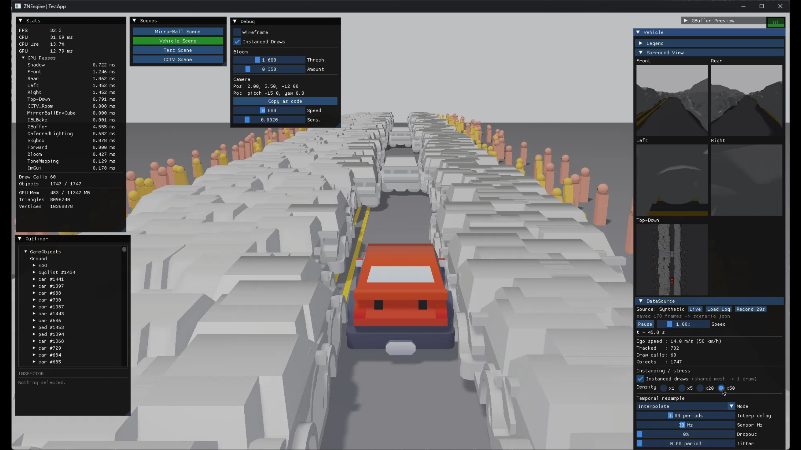
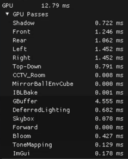

# ZNEngine — Automotive Surround-View Demo

A real-time 3D visualisation demo built on a from-scratch C++ / Direct3D 12 engine.
Sensor-style tracking data is bound to a scene graph through an interface that the scene
knows nothing about — the data source can be swapped without the renderer noticing.

**Stack** C++17 · Direct3D 12 · HLSL · custom engine (no Unreal / Unity)
**Links** [Repository](https://github.com/j-jiwon/ZNEngine.git) · [Demo video (2 min +)](https://youtu.be/_2CfJv7DidY) · [Windows build](TODO)


---

## The problem

A system that draws a driving scene in 3D has its **input change underneath it** for the whole
life of the project. You start with synthetic data, then replay recorded logs, and eventually
attach a real sensor stack. The picture on screen has to be the same in all three cases.

A second problem stacks on top of it: **the sensor rate and the display rate are different.**
Feeding 30 Hz data straight to a 120 Hz screen makes objects step rather than move. Real inputs
add dropped frames and latency on top of that.

The third is lifetime. Tracked objects are **created and destroyed every frame** as they enter
and leave the sensor's field of view. Hold scene objects by raw pointer and you will eventually
hold a pointer to something that has been freed.

---

## Design



**The point is that `SceneBinding` does not know where the data came from.** It receives a
`FrameData` — timestamp, ego state, list of tracked objects — and reconciles it against the scene
graph every frame: spawn new ids, release vanished ones, update the rest. Switching sources is
a pointer assignment.

`FrameInterpolator` sits above that and resamples sensor Hz to render fps. Off / Interpolate /
Extrapolate are selectable, and **dropout, jitter and latency can be injected deliberately** so
the behaviour under degraded input is something you can watch rather than imagine.

**Ownership.** The scene owns its objects in a **slot pool with generation counters**. A handle is
`{slot index, generation}`; when a freed slot is reused its generation increments and every stale
handle to it becomes invalid on its own. The render list is not maintained separately — it is
**derived from that ownership pool** each frame.

> To be precise: this is **not an object pool**. What gets reused is the slot index and its
> generation; the objects themselves are constructed and destroyed. That was a deliberate call
> not to optimise ahead of measurement.

**Multi-camera.** Front / rear / left / right perspective views plus a top-down orthographic view
render to offscreen targets and are composited into the panel. Drawing the same scene from several
viewpoints in one frame turns out to matter a great deal in the profiling below.

---

## Profiling

### Instrument first

Three things went in before any optimisation: **per-pass GPU timestamps** on the render graph,
a **per-frame draw-call counter**, and a **traffic-density multiplier** (×1 / ×5 / ×20 / ×50).
The optimisation itself is behind a **runtime checkbox**, so before and after come from the same
build, the same session and the same camera with exactly one variable flipped.

### Observation

The scene draws the same geometry **seven times per frame** — one shadow pass, five surround views,
one main view. Tracked objects share a mesh and material per class, yet each object was being
submitted as its own draw call.



Every object added to the scene is therefore paid for seven times over, which is why the draw-call
count reaches four figures from a few hundred objects.

### Change

Objects sharing a mesh are batched into instanced draws. Per-instance world matrices go up in a
`StructuredBuffer` and are indexed by `SV_InstanceID`. Only meshes with two or more instances are
batched; everything else falls through the original per-object path. This is applied across all
three pass families — GBuffer, shadow and offscreen. The shadow pass filters shadow casters
**before** batching, so a mesh shared by casters and non-casters batches only its casters.

> Because materials are bound to meshes in the existing design, "same mesh" already implied
> "same material", and the grouping key collapsed to a single mesh pointer. **The design made
> the optimisation cheap.**

### Results

| | 81 objects OFF | 81 objects ON | 1,747 objects OFF | 1,747 objects ON |
|---|---|---|---|---|
| **Draw calls / frame** | 407 | **60** | 7,267 | **60** |
| Frame time | 16.22 ms | **8.09 ms** | 201.54 ms | **31.09 ms** |
| GPU frame time | 6.41 ms | **4.16 ms** | 76.26 ms | **12.79 ms** |
| FPS | 61.7 | **123.6** | 5.0 | **32.2** |
| Triangles | 207,740 | 207,740 | 8,096,740 | 8,096,740 |

| Instanced draws OFF | Instanced draws ON |
|---|---|
|  |  |
| 1,747 objects · 7,267 draw calls · 201.5 ms · 5.0 FPS | 1,747 objects · **60** draw calls · **31.1 ms** · **32.2 FPS** |

**The draw-call count is flat with respect to object count.** Objects grow 21× (81 → 1,747) and
submissions do not move. The triangle counts are identical on both sides — nothing was removed
from the scene, only the way it is submitted changed.

At 1,747 objects the frame is **6.5× faster** (201.5 → 31.1 ms). 5 FPS is unusable; 32 FPS is a
demo you can drive.

### Two results I did not expect

**1. GPU time dropped as much as CPU time.**

Draw calls are usually discussed as a CPU cost. Yet with an identical triangle count, GPU time fell
from 76.26 ms to 12.79 ms — **6.0×**. At around seven thousand submissions the GPU-side command
processing and state changes are a bottleneck of their own. CPU-side time (frame minus GPU) fell
125.3 → 18.3 ms, or 6.8×. The two axes falling by nearly the same ratio is what supports the claim
that the submissions themselves were the cost.

**2. The win scales with object count.**

| | 81 objects | 1,747 objects |
|---|---|---|
| Frame time | 2.0× | **6.5×** |
| GPU time | 1.5× | **6.0×** |

At 81 objects the GPU win is only 1.5×, because submission cost is not yet dominant there.
**The measured fact is not "instancing always wins" but "the win grows with object count"** —
which is why the optimisation stayed behind a runtime toggle instead of becoming unconditional.

### Where the cost actually is



*Per-pass breakdown at 1,747 objects, instanced draws ON, GPU 12.79 ms*

| | 81 obj ON | 1,747 obj OFF | 1,747 obj ON |
|---|---|---|---|
| Surround views (5) | 39.1% | **66.1%** | 46.9% |
| Main view (GBuffer + lighting) | 38.0% | 24.6% | 40.9% |
| Fullscreen post (skybox · bloom · tonemap) | 15.6% | 0.8% | 5.0% |
| Shadow | 2.8% | 8.2% | 5.6% |

**Adding one more offscreen view looks like UI layout work; it is actually drawing the scene again.**
The five surround views together match or exceed the main view. Fullscreen post scales only with
resolution — it sits at a fixed 0.65 ms in every configuration — so its share vanishes as load grows.
The next thing worth optimising is surround-view resolution and frustum culling, not more instancing.

---

## Measurement setup

```
Build       Release | x64                    VSync   off
Resolution  1920 x 1080 (backbuffer = window client area)
Scene       VehicleScene · SyntheticSource (live) · 5 surround views on · fixed camera
Objects     81 (default) / 1,747 (traffic density x50)   tracks: 16 / 702
CPU         AMD Ryzen 5 5600X (6C/12T)        RAM     32 GB
GPU         NVIDIA GeForce RTX 3060 12GB
Instruments per-pass GPU timestamps + per-frame draw-call counter (built into the engine)
```

All four captures come from **one session within 25 seconds** (t = 37 s / 46 s / 50 s / 62 s).
Nothing was rebuilt or restarted; the only things that changed were a checkbox and a radio button.
For a few seconds after the density multiplier changes, objects are still spawning and the numbers
have not settled — captures were taken after they did.

Per-pass times sum to within 0.02 ms of the panel's GPU total in every configuration
(e.g. 12.77 vs 12.79).

---

## Known limitations

Listing weaknesses in a portfolio piece may look odd. It is what makes the numbers above credible.

- **No frame pipelining.** The CPU waits on the GPU at the end of each frame, which is why the GPU
  wait is included in the frame times above. Double-buffered command allocators and a per-frame
  fence are the next step.
- **No frustum culling or LOD.** Offscreen objects are still submitted. The numbers above are
  measured without culling.
- **No automatic render-graph ordering.** Pass execution order depends on registration order.
- **Environment map input is LDR.** SceneColor, tonemap and bloom run on an `R16G16B16A16_FLOAT`
  path, but the step that resamples the equirectangular panorama into a cubemap is 8-bit, so IBL
  highlight energy is already clipped at the source.
- **One directional shadow only.** No spot or point shadows, no cascades.

---

## Appendix — the renderer

Deferred shading (6 MRTs) with an HDR SceneColor, bloom and tonemapping. Every pass is registered
with a render graph that inserts resource-state transitions automatically. The same engine's
MirrorBall scene implements PBR with split-sum IBL and **analytic disco caustics**, solving for the
light spots by inverting the mirror-ball facet grid rather than tracing them.
