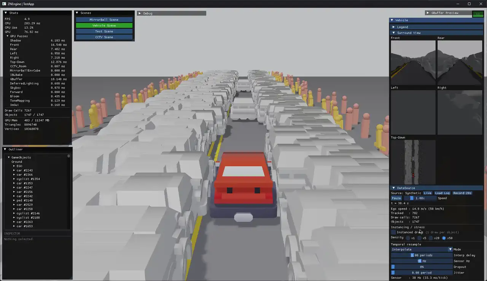
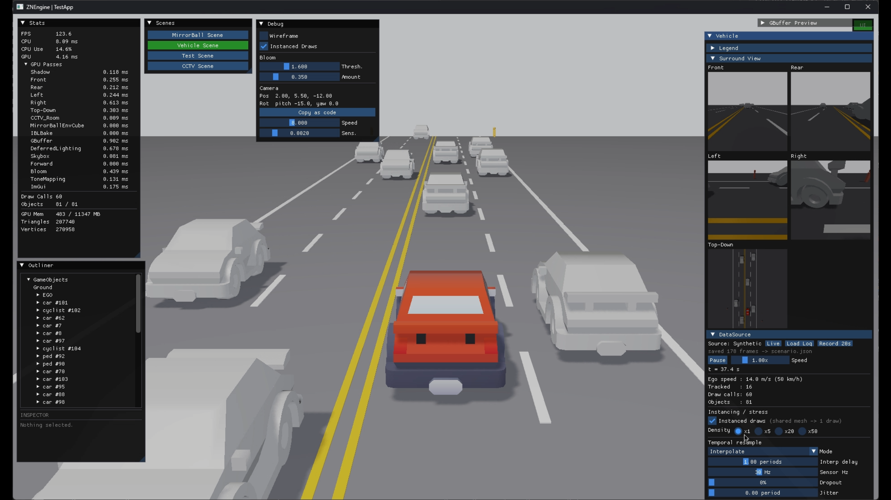
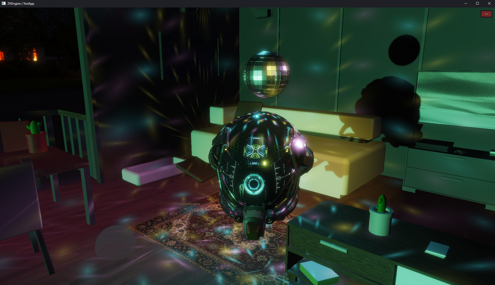
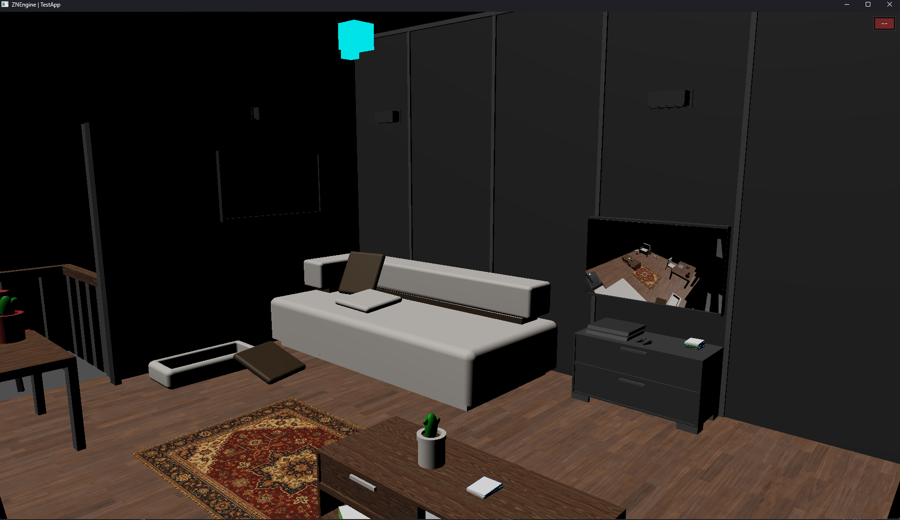
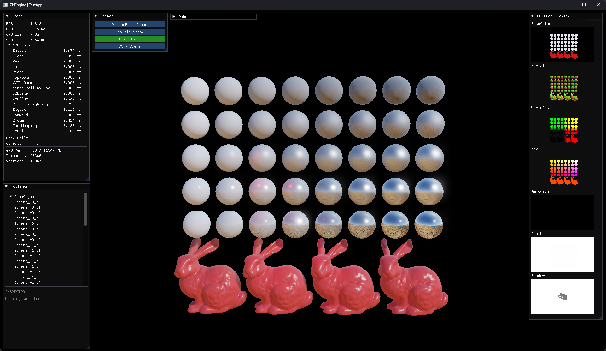

# ZNEngine

A custom real-time 3D rendering engine built in C++ and Direct3D 12 — no Unreal, no Unity.
Its automotive demo feeds sensor-style tracking data into the scene graph through a source-agnostic
pipeline, allowing synthetic traffic and recorded logs to share the same interpolation and
scene-binding code.



**[Demo video (2:33)](https://youtu.be/_2CfJv7DidY)** · **[Case study](Docs/CASE_STUDY.md)** · **[Windows build](https://github.com/j-jiwon/ZNEngine/releases/latest)**

---

## What it does

**Automotive surround-view demo** — the scene the engine was built to drive.

- `IDataSource → FrameData → SceneBinding → scene graph`; synthetic traffic and JSON log replay
  are interchangeable behind one interface
- Sensor-rate data is resampled to the display frame rate; dropout, jitter and latency can be
  injected at runtime
- Front / rear / left / right perspective views plus a top-down orthographic view, rendered
  offscreen and composited
- Record the live stream to JSON, then replay it with seeking, scrubbing and looping

**Renderer**

- Deferred shading into six G-buffer targets; lighting, bloom and tone mapping run through an FP16
  SceneColor path, while environment-map input is currently 8-bit LDR
- PBR with split-sum image-based lighting from scene-captured or equirectangular environment maps
- Analytic disco caustics — light spots solved by inverting the mirror ball's facet grid
- Render graph with automatic resource-state transitions
- Slot/handle scene ownership with generation counters, so stale handles are rejected after object
  destruction or slot reuse
- Per-pass GPU timestamps, a draw-call counter and a live G-buffer preview, built in

---

## Instanced draws

The demo submits the same geometry seven times per frame — one shadow pass, five surround views,
one main view. Batching objects that share a mesh keeps the draw-call count flat for this
repeated-asset workload:

| | 81 objects | 1,747 objects |
|---|---|---|
| Draw calls, per-object | 407 | 7,267 |
| Draw calls, instanced | **60** | **60** |
| Frame time | 16.22 → **8.09 ms** | 201.54 → **31.09 ms** |
| GPU frame time | 6.41 → **4.16 ms** | 76.26 → **12.79 ms** |

Identical triangle counts on both sides. RTX 3060, 1920×1080, Release x64, VSync off.
The measurement setup, the per-pass breakdown and two counterintuitive results
are in the **[case study](Docs/CASE_STUDY.md)**.

---

## Scenes

| Scene | What it shows | Screenshot |
|---|---|---|
| **Vehicle** | The automotive demo — data sources, resampling, surround views, instancing ||
| **MirrorBall** | PBR, image-based lighting, analytic disco caustics ||
| **CCTV** | Offscreen camera rendered into a material on a TV mesh in the same scene ||
| **Test** | Roughness × metallic sphere grid for shading validation ||

---

## Building

```
Visual Studio 2022 · MSVC v143 · C++20 · Windows 10/11 x64
```

Open `ZNEngine.sln`, build **Release | x64**, run `TestApp`.
Assets are resolved relative to the executable, falling back to the repository layout when running
from the build directory, so both `F5` and a packaged folder work.

To produce a distributable folder:

```powershell
.\Tools\package.ps1
```

Prebuilt binaries are on the [releases page](https://github.com/j-jiwon/ZNEngine/releases/latest).
They need the [Visual C++ Redistributable (x64)](https://aka.ms/vs/17/release/vc_redist.x64.exe) —
the release build links the CRT dynamically.

---

## Layout

```
ZN/ZNFramework/          engine
  Application/           app loop and initialisation
  Window/                Win32 window and events
  Graphics/              renderer; Platform/Direct3D12 holds the implementation
    Platform/Direct3D12/Passes/    render-graph passes
  Scene/                 ZNScene, ZNGameObject, ZNObjectHandle
  Math/                  vector / matrix / transform (no DirectXMath)
  UI/                    ImGui layer
TestApp/Framework/       sample scenes
  Vehicle/               automotive subsystem: sources, interpolation, binding, log format
Resources/               shaders, models, textures
Docs/                    case study, third-party licences
```

The engine is split into a platform-agnostic interface layer (`ZNXxx`) and a Direct3D 12
implementation behind factory functions, so `TestApp` never sees a D3D12 type.

---

## Licence

ZNEngine-authored source code and first-party assets are [BSD 3-Clause](LICENSE). Bundled libraries
and third-party assets retain their own terms; Damaged Helmet and Stanford Bunny restrict
commercial use. See [Third-Party Licenses](Docs/THIRD_PARTY_LICENSES.md) before redistribution or
reuse.
